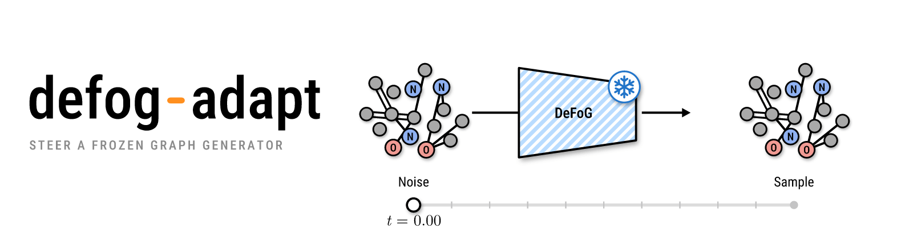
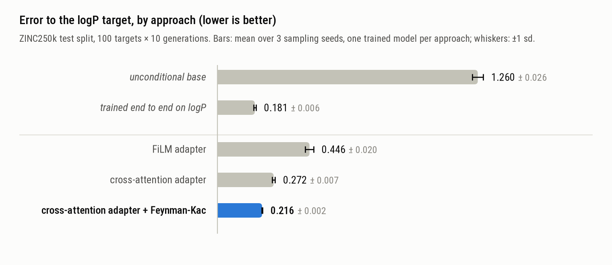

<h1 align="center">
  
</h1>

<p align="center">
  <a href="https://github.com/aimat-lab/defog-adapt/actions/workflows/ci.yml"></a>
  
  <a href="LICENSE"></a>
</p>

Steer a frozen [DeFoG](https://arxiv.org/abs/2410.04263) discrete flow-matching graph generator toward a property
target with small swappable **adapters**, inference-time **Feynman-Kac steering** and **reinforcement-learning
fine-tuning**. Molecules are the validated domain, and only features with a recorded positive result are included
([what was left out, and why](docs/migration.md#what-was-removed)).

## 📦 Installation

```bash
pip install "defog-adapt[chem]"
```

That is the whole install. The `chem` extra adds RDKit, the molecular domain that every recorded result uses; it is
an extra because the core is domain-agnostic graph code and RDKit is a large compiled dependency. Everything else
comes with the package. To work from a clone instead:

```bash
git clone https://github.com/aimat-lab/defog-adapt && cd defog-adapt
pip install -e ".[chem]"
```

Python 3.10 or newer, PyTorch 2.1 or newer, PyTorch Geometric 2.3 or newer and PyTorch Lightning 2.4 or newer. The
package is `defog_adapt`; it does not clash with the unrelated `defog` package on PyPI. The recipes in
[`examples/`](examples/README.md) also need [PyComex](https://pypi.org/project/pycomex/) (`pip install pycomex`),
which is not bundled because it caps numpy below 2.

<details>
<summary>Installation problems?</summary>

* **You want a GPU build, or a CPU-only one, of PyTorch.** Install PyTorch for your platform first
  ([pytorch.org](https://pytorch.org/get-started/locally/)), then defog-adapt: pip keeps the PyTorch you installed.
  Otherwise pip picks a build for you.
* **There is no RDKit wheel for your platform.** Install RDKit from conda-forge first
  (`conda install -c conda-forge rdkit`), then install defog-adapt in the same environment.

</details>

## 📊 Results at a glance

<p align="center">
  
</p>

The model trained end to end on the property had the lowest error. An adapter on a frozen base gets most of the way
there, and Feynman-Kac steering closer still, at a cost in sample diversity (uniqueness 0.79, against 1.0 for the
others). Each approach was trained once, and the 0.035 between the end-to-end model and the steered adapter is smaller
than the 0.058 recorded between two trainings of one adapter recipe, so this comparison does not order those two. Every
number, its protocol and what it does not support are in [`docs/results.md`](docs/results.md) and
[`docs/caveats.md`](docs/caveats.md).

## 🚀 Quickstart

Everything here runs on a CPU, with no downloads and no checkpoints. This trains a toy DeFoG model and a logP
adapter on a few dozen small molecules, then samples with the adapter steered toward two logP targets (about half a
minute):

```python
import pytorch_lightning as pl
import torch
from rdkit import Chem
from rdkit.Chem import Crippen
from torch_geometric.loader import DataLoader

from defog_adapt.core import (
    CrossAttentionAdapter,
    AdapterComposition,
    AdapterModule,
    AdaptedSampler,
    ConditionBranch,
    DeFoGModel,
)
from defog_adapt.domains.molecule import (
    build_encoders,
    mol_to_smiles,
    pyg_data_to_mol,
    smiles_to_pyg_data,
)
from defog_adapt.presets import ADAPTER_WEIGHT

EPOCHS = 120  # training epochs, for the base model and again for the adapter
N = 64        # molecules to sample per target

pl.seed_everything(0)

# A few dozen small molecules: enough to run the whole pipeline, far too few to be good.
smiles = """
    CCO CCCO CCCCO CCCCCO
    CCN CCCN CCCCN
    CCOC CCCOC CCOCC
    CC(C)O CC(C)N CC(C)C CCC(C)C
    CC(=O)C CCC(=O)C
    CC(=O)O CCC(=O)O CC(=O)N
    NCCO NCCN OCCO OCCCO
    CNC CCNCC CN(C)C
    C1CCCCC1 C1CCCC1 C1CCNCC1 C1CCOCC1 OC1CCCCC1
    c1ccccc1 Cc1ccccc1 CCc1ccccc1 Oc1ccccc1 Nc1ccccc1 COc1ccccc1
    c1ccncc1 Cc1ccncc1 OCc1ccccc1
""".split()

# Molecules become graphs (atoms and bonds as classes).
# Each graph carries the property the adapter learns: logP.
atom_enc, atom_dec, bond_enc, bond_dec = build_encoders(
    atom_types=["C", "N", "O"],
    bond_types=["SINGLE", "DOUBLE", "TRIPLE"],
)
graphs = []
for s in smiles:
    g = smiles_to_pyg_data(s, atom_enc, bond_enc, kekulize=True)
    g.cond = torch.tensor([[Crippen.MolLogP(Chem.MolFromSmiles(s))]])
    graphs.append(g)
loader = DataLoader(graphs, batch_size=16, shuffle=True)
logp = torch.cat([g.cond for g in graphs])


def fit(module):
    trainer = pl.Trainer(
        max_epochs=EPOCHS,
        accelerator="cpu",
        logger=False,
        enable_progress_bar=False,
        enable_model_summary=False,
        enable_checkpointing=False,
    )
    trainer.fit(module, loader)


# 1. An unconditional DeFoG model.
base = DeFoGModel.from_dataloader(loader, n_layers=2, hidden_dim=32)
fit(base)
base.eval()

# 2. The base stays frozen: only the adapter trains.
adapter = CrossAttentionAdapter.for_base(
    base,
    cond_dim=1,
    cond_mean=[float(logp.mean())],
    cond_std=[float(logp.std())],
)
fit(AdapterModule(base, adapter))
adapter.eval()

# 3. Sample, steered toward a logP target.
for target in (0.0, 2.0):
    branch = ConditionBranch(adapter, torch.tensor([target]), ADAPTER_WEIGHT["logp"])
    composition = AdapterComposition([branch], base=base)
    sampler = AdaptedSampler(base, composition, sample_steps=60)
    graphs_out = sampler.sample(N, device=torch.device("cpu"), show_progress=False)

    # Decode the graphs back to molecules (None where a graph is not a molecule).
    decoded = [pyg_data_to_mol(g, atom_dec, bond_dec) for g in graphs_out]
    found = [mol_to_smiles(m) for m in decoded if m is not None]
    values = [Crippen.MolLogP(Chem.MolFromSmiles(smi)) for smi in found if smi]

    mean_logp = sum(values) / max(len(values), 1)
    print(
        f"target logP {target:.1f}: {len(values)}/{N} valid, "
        f"mean logP {mean_logp:.2f}, e.g. {found[:3]}"
    )
```

It prints one line per target, after some start-up messages from PyTorch Lightning (the details vary a little
between machines and versions):

```text
target logP 0.0: 57/64 valid, mean logP -0.26, e.g. ['NCCO', 'CC(O)CO', 'NC1=[O+]C(O)O1.O']
target logP 2.0: 58/64 valid, mean logP 1.95, e.g. ['CCC(CC)CC', 'CC1CCC1C', 'CCCC']
```

**This is a wiring check, not a result.** The model is tiny and sees a few dozen molecules, so expect some odd ones
among the samples; what it shows is the idea: one frozen base, and a small adapter that moves the samples toward the
property you ask for. The same code at scale produced the numbers [above](#-results-at-a-glance). For a tour of every
building block (property head, size model, Feynman-Kac steering), run [`examples/quickstart_cpu.py`](examples/quickstart_cpu.py)
from a clone.

<details>
<summary>With real checkpoints: Feynman-Kac steering</summary>

To steer a real model you need trained checkpoints. None ship with 0.1; the recipes in
[`examples/`](examples/README.md) train them. The assembly is [`examples/steer_zinc.py`](examples/steer_zinc.py),
and the core of it is:

```python
import torch

from defog_adapt.core import (
    CrossAttentionAdapter,
    AdapterComposition,
    ConditionBranch,
    DeFoGModel,
    FeynmanKacSampler,
    LearnedPropertyEnergy,
    LearnedSizeDistribution,
    PropertyHead,
    StandardisedEnergy,
)
from defog_adapt.data import zinc_reference
from defog_adapt.domains import MoleculeDomain
from defog_adapt.domains.molecule import build_encoders
from defog_adapt.presets import ADAPTER_SAMPLING, ADAPTER_WEIGHT, FK_STEERING

atom_enc, atom_dec, bond_enc, bond_dec = build_encoders(
    atom_types=zinc_reference.ATOM_TYPES,
    bond_types=zinc_reference.BOND_TYPES,
)
domain = MoleculeDomain(atom_dec, bond_dec)

# One frozen base, one file per property.
base = DeFoGModel.load("base.ckpt")
adapter = CrossAttentionAdapter.load("logp_adapter.ckpt")

# The Feynman-Kac "ruler", and the node counts drawn from P(n | target).
head = PropertyHead.load("logp_head.ckpt")
size = LearnedSizeDistribution.load("logp_head_size.ckpt")

target = 4.0
std = float(head.prop_std)

branch = ConditionBranch(adapter, torch.tensor([target]), ADAPTER_WEIGHT["logp"])
composition = AdapterComposition([branch], base=base)

prop_energy = LearnedPropertyEnergy(head, target, domain, atom_enc, bond_enc, scale=std)
energy = StandardisedEnergy([(prop_energy, std)])

sampler = FeynmanKacSampler(
    base,
    energy,
    composition=composition,
    **FK_STEERING,
    **ADAPTER_SAMPLING,
)
graphs = sampler.sample(10, size_dist=size, condition=torch.full((10, 1), target))
```

</details>

## 🧩 What is in it

| | what it does | evidence |
|---|---|---|
| **Frozen-base adapters** (`CrossAttentionAdapter`, `AdapterModule`, `AdapterComposition`) | A small conditional adapter over a frozen unconditional base: swappable (one file per property) and composable (two properties multiply). Node cross-attention and Fourier bands on the condition. | logP, QED, TPSA and SAScore on ZINC250k; joint logP + QED; Morgan fingerprints |
| **Learned size model** (`LearnedSizeDistribution`) | Draw the node count from `P(n \| target)` instead of the dataset marginal. | -0.0103 logP and -0.0058 QED error |
| **Feynman-Kac steering** (`FeynmanKacSampler`, `StandardisedEnergy`, `PropertyHead`) | Inference-time particle steering toward a target, scored by a learned property head, with a dimensionless `beta`. | logP error 0.272 to 0.216 on the held-out test split (three seeds), at a cost in diversity (uniqueness 0.79) |
| **GDPO fine-tuning** (`GDPOTrainer`, `AdapterGDPOTrainer`) | Policy-gradient RL on the base (fewer fragments, odd rings) or on an adapter (tighter conditioning). | -13.6% logP and -19.5% QED with validity up; structural RL on ZINC |
| **Kekulized molecular representation** | Dropping the aromatic bond class makes a whole kind of validity failure impossible. | MOSES validity 0.884 to 0.991 |
| **Inpainting** (`InpaintingSampler`) | Freeze a substructure and grow the rest (RePaint-style). | *thin*: one demonstration |
| **Spectrum energy** (`SpectrumEnergy`) | Steer toward IR bands, with a predictor you supply. | *thin*: see the caveats |

## 📚 Documentation

| | |
|---|---|
| [`docs/adapters.md`](docs/adapters.md) | what an adapter is; training, composing, the label convention, the file format |
| [`docs/steering.md`](docs/steering.md) | Feynman-Kac, choosing `beta`, learned sizes, several properties, inpainting, spectra |
| [`docs/rl.md`](docs/rl.md) | structural RL and adapter RL; the operating-point and selection traps |
| [`docs/caveats.md`](docs/caveats.md) | provenance, noise, what is thin, what was removed |
| [`examples/README.md`](examples/README.md) | the recipes, in pipeline order |
| [`CHANGELOG.md`](CHANGELOG.md) | what changed in each release |

## 📝 Citation, relationship to DeFoG and license

The base model follows the upstream [DeFoG](https://github.com/qym7/DeFoG) implementation (Qin, Madeira,
Thanou, Frossard; ICML 2025). Everything built on top of it here was developed in a research fork. This package is
**not affiliated with or endorsed by the DeFoG authors**; see [`NOTICE`](NOTICE) for the full credits and the
papers behind each method. If you use it, please cite this package and the DeFoG paper
([`CITATION.cff`](CITATION.cff), which GitHub turns into a "Cite this repository" button).

<details>
<summary>BibTeX</summary>

```bibtex
@software{teufel2026defogadapt,
  author = {Teufel, Jonas},
  title  = {defog-adapt},
  year   = {2026},
  url    = {https://github.com/aimat-lab/defog-adapt}
}

@inproceedings{qin2025defog,
  title     = {{DeFoG}: Discrete Flow Matching for Graph Generation},
  author    = {Qin, Yiming and Madeira, Manuel and Thanou, Dorina and Frossard, Pascal},
  booktitle = {International Conference on Machine Learning (ICML)},
  series    = {Proceedings of Machine Learning Research},
  volume    = {267},
  year      = {2025},
  url       = {https://arxiv.org/abs/2410.04263}
}
```

</details>

MIT, see [`LICENSE`](LICENSE). The upstream copyright notice is retained.

## 🤝 Contributing

Issues and pull requests are welcome; please read [`CONTRIBUTING.md`](CONTRIBUTING.md) first. It explains the one rule
specific to this project (a feature needs a recorded positive result), how to run the tests and what the checks
guard. To report a vulnerability, see [`SECURITY.md`](SECURITY.md).
