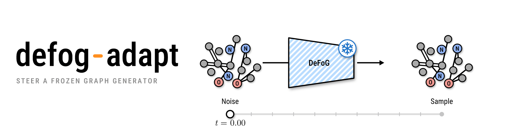

# 

**defog-adapt** steers a frozen [DeFoG](https://arxiv.org/abs/2410.04263) graph generator toward a property
target. DeFoG is a discrete flow-matching model for graph generation, and molecules are the domain this package
has been validated on. Ask for molecules whose logP is near 4 from a model that was trained without any notion of
logP, and get them without retraining it.

Three tools do the steering:

- **Adapters.** A small file per property that turns the frozen, unconditional model into a conditional one.
- **Feynman-Kac steering.** At sampling time, a population of candidates is resampled toward the target.
- **RL fine-tuning.** Policy-gradient fine-tuning of the model against a reward on the generated molecule.

Each works on its own, and adapters and Feynman-Kac steering work together. The gains from RL fine-tuning and from
Feynman-Kac steering do not add up.

[How they work](concepts.md){ .md-button } [Run the quickstart](getting-started.md){ .md-button .md-button--primary }

## Install

```bash
pip install "defog-adapt[chem]"
```

You need Python 3.10 or newer and PyTorch 2.1 or newer. The `chem` extra adds RDKit, the molecular domain that
every recorded result uses.

## The idea in a few lines

```python
import torch

from defog_adapt.core import (AdaptedSampler, AdapterComposition, ConditionBranch,
                              CrossAttentionAdapter, DeFoGModel)
from defog_adapt.presets import ADAPTER_SAMPLING, ADAPTER_WEIGHT

base = DeFoGModel.load("base.ckpt")                        # one frozen, unconditional model
adapter = CrossAttentionAdapter.load("logp_adapter.ckpt")  # a small file per property

branch = ConditionBranch(adapter, torch.tensor([4.0]), ADAPTER_WEIGHT["logp"])   # toward logP 4
sampler = AdaptedSampler(base, AdapterComposition([branch], base=base), **ADAPTER_SAMPLING)
graphs = sampler.sample(10)                                # ten molecular graphs
```

## Results at a glance


The model trained end to end on the property had the lowest error. An adapter on a frozen base gets most of the way
there, and Feynman-Kac steering closer still, at a cost in sample diversity (uniqueness 0.79, against 1.0 for the
others). Each approach was trained once, and the 0.035 between the end-to-end model and the steered adapter is smaller
than the 0.058 recorded between two trainings of one adapter recipe, so this comparison does not order those two. Every
number, its protocol and what it does not support are in
[`docs/results.md`](https://github.com/aimat-lab/defog-adapt/blob/main/docs/results.md) and
[`docs/caveats.md`](https://github.com/aimat-lab/defog-adapt/blob/main/docs/caveats.md).

## Before you start

- **No trained models ship with the package.** You train the base model and the adapters with the
  [recipes](reference/recipes.md). The [quickstart](getting-started.md) runs the whole pipeline on a toy problem in
  about half a minute, with no downloads.
- **Molecules are the validated domain.** The core is ordinary graph code, but nothing else has been measured. See
  the [limits](about/limits.md).
- **Only features with a recorded positive result are included.** What was tried and did not work was left out on
  purpose, so a new feature has to arrive with its evidence.
